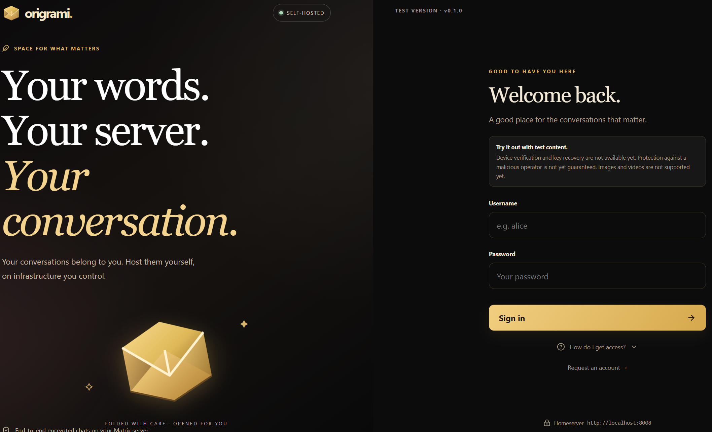
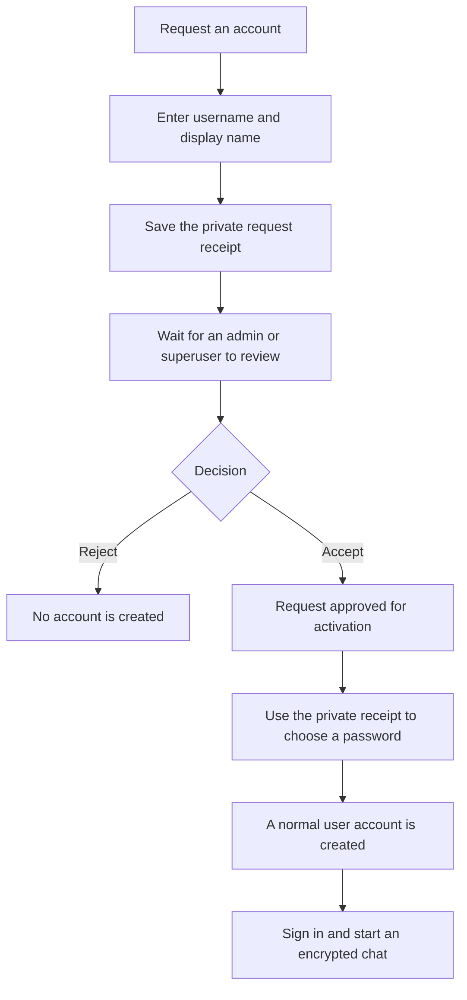

# Origrami

**Your words. Your server. Your conversations.**

Origrami is a messenger you can host yourself. You choose the infrastructure that stores accounts and messages, and you decide who can join. Families, friends and communities should be able to communicate privately without entrusting their conversations to a central messaging platform.

The goal is to encrypt private content on participants' devices and decrypt it only on those devices. Administrators manage access and availability without receiving private message keys or a dashboard for reading other people's conversations.



## What can Origrami do?

- Run a self-hosted, closed Matrix instance using Synapse and PostgreSQL.
- Exchange end-to-end encrypted text messages in private and named group chats with invitations, search and conversation drafts.
- Review account requests: an administrator must approve a request before its account can be activated.
- Manage searchable requests, individual and bulk decisions, users, a blocklist and an activity log.
- Protect superuser accounts and restrict CPU, memory and disk statistics to superusers unless they grant administrators access.
- Provide an English interface with black/gold and burgundy colour palettes.

**Current status: local prototype, version 0.1.** Encrypted text chats are implemented. Images, videos, files, device verification and key recovery are not available yet. Self-hosting gives you control of infrastructure; it does not make communication anonymous or provide complete protection against a malicious operator or modified client code. Account and traffic metadata remain visible to the operator. See the [security model](SECURITY.md).

## Prerequisites

| Requirement | Details |
|---|---|
| Docker | A running Docker Engine for Linux containers. On Windows or macOS, use Docker Desktop with Linux containers enabled. |
| Docker Compose | Compose v2 or later, available as `docker compose`. |
| Project files | A local checkout or extracted source archive in a writable directory. Git is only needed for cloning. |
| Terminal | PowerShell on Windows, or the normal terminal on Linux/macOS. |
| Browser | A current browser with WebAssembly, IndexedDB, session storage and Web Locks enabled. |
| Free ports | `5173` for the application, `8008` for Matrix and `8090` for management. Optional live development uses `5174`. |
| Network and storage | Internet access for initial image/package downloads; disk space in Docker for images, build cache and persistent data volumes. |

**No host installation of Node.js, npm, Python, PostgreSQL, Nginx or OpenSSL is required.** Setup, builds, tests and live web development run in containers. Dependencies, caches and build output stay inside Docker; the project directory contains source, documentation and local `.env` configuration.

Check Docker before starting:

```sh
docker version
docker compose version
docker info --format '{{.OSType}}'
```

The last command should print `linux`. See [operations](docs/operations.md#requirements) and the [container build guide](docs/builds.md).

## Quick start with three test accounts

Complete the [prerequisites](#prerequisites), then run all commands from the project directory.

**Windows / PowerShell:**

```powershell
docker compose -f compose.tools.yaml run --rm setup
docker compose -f compose.yaml -f compose.test.yaml up --build -d --wait
```

**Linux / macOS:**

```sh
docker compose -f compose.tools.yaml run --rm --user "$(id -u):$(id -g)" setup
docker compose -f compose.yaml -f compose.test.yaml up --build -d --wait
```

The setup container creates a local `.env` with a random database password without overwriting an existing file. On Linux/macOS, the `--user` option makes the configuration file belong to your current user. Compose builds the application images, starts the services and automatically creates missing test accounts. Existing accounts, passwords and volumes are preserved. For an existing installation, read the [update instructions](docs/operations.md#updates) first.

Open **[localhost:5173](http://localhost:5173)**:

| Username | Test password | Origrami role |
|---|---|---|
| `alice` | `alice` | Superuser |
| `bob` | `bob` | User |
| `charlie` | `charlie` | User |

Alice can open **Server management**. Bob and Charlie start as normal users and can be promoted to administrator by Alice. Use a separate browser profile for each account. These published passwords are for local testing only. None of these accounts has native Matrix administrator privileges.

To try a chat, sign in as Alice and invite Bob using **New conversation**. Sign in as Bob, choose **Accept invitation**, and send a text message.

To try a group, choose **Group chat** in the new-conversation dialog, enter a group name and invite `bob, charlie`. Open each account in a separate browser profile, accept both invitations, then exchange messages. See the [group chat guide](docs/usage.md#start-a-group-chat).

**Stop and restart:**

```sh
docker compose -f compose.yaml -f compose.test.yaml down
docker compose -f compose.yaml -f compose.test.yaml up -d --wait
```

Use the same Compose files for both commands. `down` preserves data volumes. **Do not use `down -v` for a normal shutdown:** it deletes data, including accounts, messages, server keys and management state.

The supplied configuration binds published ports to `127.0.0.1` and disables federation. It is not a complete public Internet deployment. You can use the [base configuration](compose.yaml) without test accounts by provisioning your own accounts and superusers; see [operations](docs/operations.md) and [administration](docs/administration.md#configure-superusers).

## From an account request to the first sign-in

New users choose **Request an account** on the sign-in screen. Submitting a request does not create a Matrix account.



The private **receipt** is required to check the request and activate an approved account. Keep it secret and save it. Administrators can search by username or display name and review individual requests, a selection, or all matching requests. See [registration and decisions](docs/administration.md#registration-and-decisions).

## User types and permissions

Administrators and superusers remain normal chat users. Additional management permissions are checked on the server.

| Capability | User | Admin | Superuser |
|---|---|---|---|
| Use their own chats | Yes | Yes | Yes |
| View usernames and account listings | No | Yes | Yes |
| Search, accept and reject account requests | No | Yes | Yes |
| Make bulk decisions and manage the blocklist | No | Yes | Yes |
| Deactivate ordinary accounts and promote users to admin | No | Yes | Yes |
| Demote or deactivate admins | No | No | Yes |
| View server load | No | Only with permission | Yes |
| Grant admins access to server load | No | No | Yes |
| Modify or deactivate superusers through the dashboard | No | No | No |
| Read other people's conversations or private keys through management | No | No | No |

Superusers are configured using `ORIGRAMI_SUPERUSERS` in the local `.env`. Administrators cannot demote or deactivate them. **Deactivate** removes server access and revokes sessions; it is not a temporary room kick. The internal service account and native Matrix administrator credentials are separate from human Origrami roles. See the [complete role description](docs/administration.md#roles).

## A look inside the chat


These screenshots show local test accounts and sample data. The administration guide includes pictures of [registration management](docs/administration.md#registration-and-decisions) and the [server overview](docs/administration.md#overview-and-server-load).

**Preserve your keys:** signing in again creates a new Matrix device. Existing local keys are not automatically transferred. Do not clear browser data as a general repair step. A server backup cannot replace lost device keys.

## Documentation

| Topic | Guide |
|---|---|
| Purpose, data ownership and architecture diagram | [Architecture and goals](docs/architecture.md) |
| Installation, updates, backups and troubleshooting | [Operations](docs/operations.md) |
| Container builds, tests and live development | [Build guide](docs/builds.md) |
| Sign-in, invitations and messages | [User guide](docs/usage.md) |
| Registration, roles, blocklist and server load | [Administration](docs/administration.md) |
| Protection and outstanding requirements | [Security model](SECURITY.md) |
| Changes | [Changelog](CHANGELOG.md) |
| Planned platforms, integrations and features | [Roadmap](docs/roadmap.md) |
| Test results and browser test checklist | [Verification report](docs/verification.md), [manual tests](docs/manual-tests.md) |

## Development

Planned development includes Kubernetes deployment, Android and iOS apps, custom emoji, backup and recovery, identity provider integration, administrator-assisted password resets, visual polish and more themes. See the [roadmap](docs/roadmap.md) for the full outlook.

Build the web client without creating a local `node_modules` or `dist` directory:

```sh
docker compose -f compose.tools.yaml run --rm --build web-build
```

Run all existing test suites in disposable containers:

```sh
docker compose -f compose.tools.yaml run --rm --build web-tests
docker compose -f compose.tools.yaml run --rm --build management-tests
docker compose -f compose.tools.yaml run --rm --build bootstrap-tests
```

For live editing, first start the application stack, then run:

```sh
docker compose -f compose.tools.yaml run --rm --build --service-ports web-dev
```

Open [localhost:5174](http://localhost:5174). Source edits are mounted read-only into the container; dependency files and Vite caches remain in Docker. Stop with Ctrl+C. The development URL is a separate browser origin, so use disposable test accounts rather than expecting existing sessions or message keys to transfer.

See the [build guide](docs/builds.md) for image stages, container setup and troubleshooting. `VITE_MATRIX_URL` selects the homeserver; the standard application uses `http://localhost:8008`. Current checks and limitations are documented in the [verification report](docs/verification.md).

Technical foundation: [Matrix Client-Server API](https://spec.matrix.org/latest/client-server-api/) and [Matrix JavaScript SDK](https://github.com/matrix-org/matrix-js-sdk). Licence: [MIT](LICENSE).
