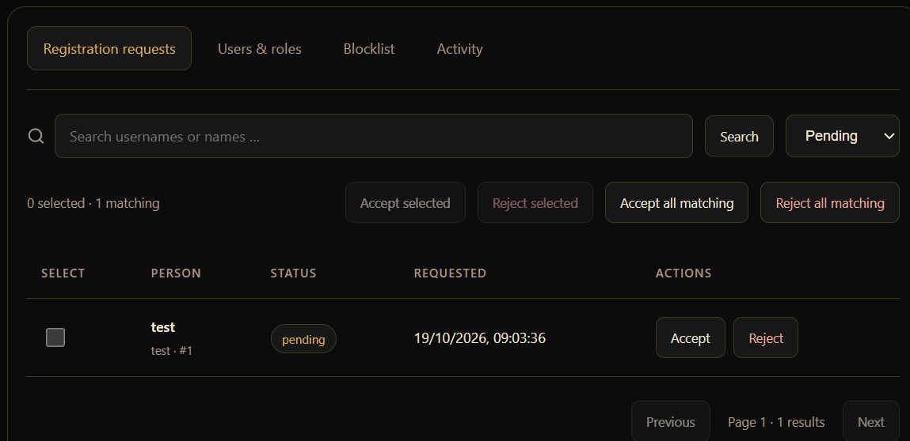
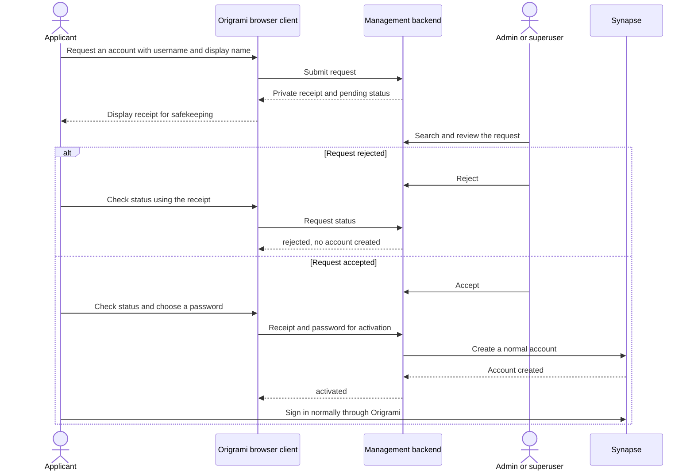
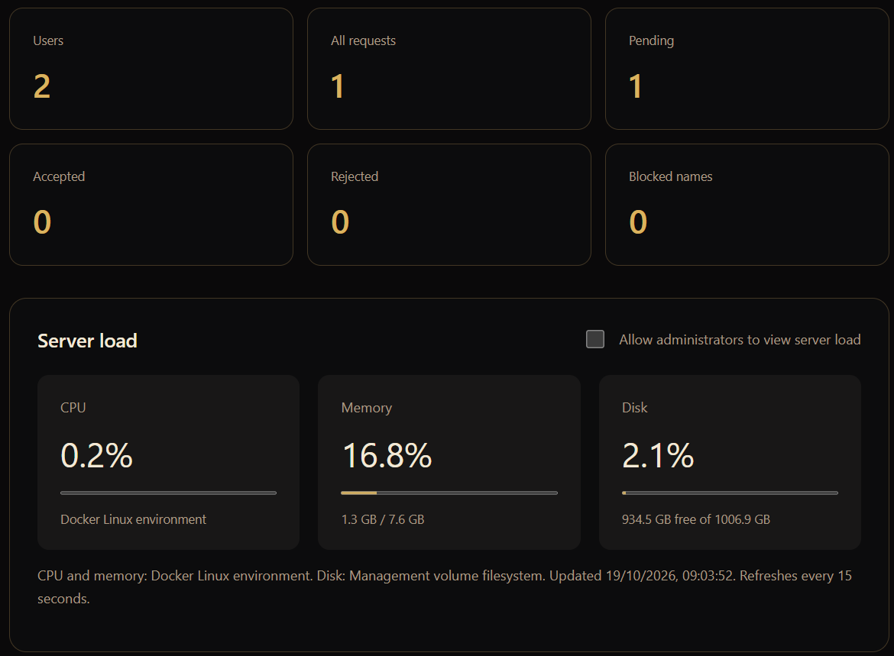
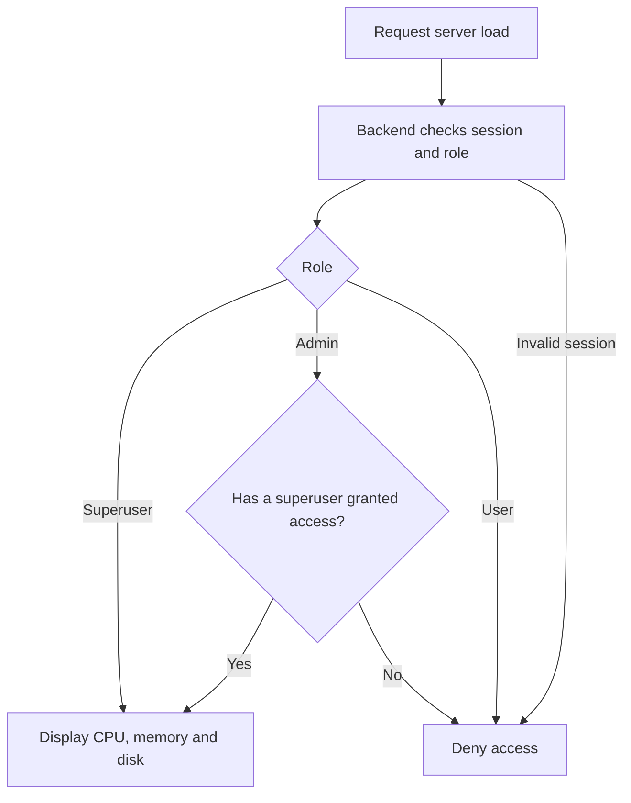

# Administration

The management dashboard uses English, just like the chat interface. After signing in, authorised users see **Server management** in the sidebar. **Back to chats** returns to chat while preserving the connection and drafts.

## Roles

| Capability | User | Admin | Superuser |
|---|---|---|---|
| Use their own chats | Yes | Yes | Yes |
| View names and account listings | No | Yes | Yes |
| Search and accept/reject requests individually or in bulk | No | Yes | Yes |
| Manage the registration blocklist | No | Yes | Yes |
| Deactivate ordinary accounts and promote users to admin | No | Yes | Yes |
| Remove admin rights or deactivate admin accounts | No | No | Yes |
| Modify/deactivate superusers through management | No | No | No |
| View CPU, memory and disk usage | No | Only with permission | Yes |
| Change permission to view server load | No | No | Yes |
| Retrieve other people's messages, media or private keys | No | No | No |

The backend enforces these restrictions, including for direct API calls. Demotion takes effect on the next request using the same session. Browsers refresh roles and data every 15 seconds. Administrators cannot demote or deactivate peers. Changes to the acting user's own account and the internal service account are blocked.

Origrami roles grant **no native Matrix administrator privileges**. An internal service account performs only the limited backend operations; its credentials never leave the backend. Existing native Matrix administrators are labelled and must be managed outside this dashboard. Operators with Docker, configuration, database or native administrator access are outside this role boundary.

## Configure superusers

The local test default is `@alice:localhost`; `bob` remains an ordinary user. After starting with `compose.test.yaml`, Alice can sign in with `alice/alice` and promote Bob using **Users & roles → Make admin**.

To designate other or multiple **local accounts you already control**, set the following in `.env`:

```dotenv
ORIGRAMI_SUPERUSERS=@alice:localhost,@owner:localhost
```

Then recreate the management service:

```sh
docker compose -f compose.yaml -f compose.test.yaml up -d management
```

This setting does not create accounts or change passwords. Provision additional owner accounts deliberately using `register_new_matrix_user --no-admin` first. Superuser names and `origrami.management` are reserved against public account requests. Complete IDs must match the Matrix server name. Never expose the known test passwords publicly.

## Registration and decisions



The picture shows the local sample request `test`. **Accept** and **Reject** handle one request. **Accept all matching** and **Reject all matching** handle the open requests matching the loaded search after confirmation.



1. Open **Request an account** on the sign-in screen and provide an available username and a display name.
2. The request receives a private **receipt**, stored in the current browser tab. Save it and restore it through **Already have a receipt?** if needed. Anyone holding this receipt can activate the approved account: keep it secret.
3. Administrators find requests under **Registration requests**, searching by username or display name. Search uses literal substrings, not wildcards. Status filters and pages of 50 requests keep the queue manageable.
4. **Accept/Reject** handles individual requests; **Accept/Reject selected** handles a selection. After confirmation, **Accept/Reject all matching** covers all open requests matching the loaded search across pages. With no search filter, it covers all open requests. An ID cutoff excludes requests that arrive later.
5. Once approved, the applicant chooses a password of at least 12 characters and activates the account. Only then is a normal Matrix account created. The request system stores no login passwords and only a hash of the private receipt.

Existing accounts cannot be taken over through a request or a competing account creation. If a connection fails exactly between Matrix account creation and local status persistence, signing in with the just-chosen password may already work; do not reset the installation. Lost receipts do not yet have an automated recovery process.

Basic bot controls allow at most 10 request attempts per source address per hour, 1,000 attempts overall per hour, 10,000 pending requests, and one open request per username. Invalid attempts count too. Addresses are hashed with a local secret for throttling and removed after an hour. People sharing an address share the limit. This does not replace a tested public abuse/DDoS defence.

## Blocklist and deactivation

The blocklist contains **exact local usernames**. Adding a name rejects its pending or accepted-but-not-activated requests and prevents new requests and account activation. Existing accounts and sessions are unaffected. **Unblock** permits new requests but does not undo previous rejections.

**Deactivate** removes server access: Synapse deactivates the account, revokes its sessions, removes it from rooms, and removes its password. The confirmation explains these effects. This is not a temporary room kick. A reactivation interface is not yet available. Messages already stored by recipients are not deleted by this action.

## Overview and server load



The figures and the `test` account in these pictures are local sample data, not performance guarantees.

The cards count accounts including deactivated accounts but excluding the internal service account, all requests, pending/accepted/rejected requests, and blocked names. Accepted requests include accounts awaiting activation and already activated accounts. These request counts do not include historical seed scripts or external account creation.

CPU and memory come from `/proc` in the Docker Linux environment. Under Docker Desktop, these are Linux VM measurements, not measurements of the entire Windows host. Disk usage describes the management volume's filesystem, not the sum of PostgreSQL and media volumes. Missing values appear as **Unavailable**. No Docker socket or privileged container is used.

Only superusers see measurements by default. **Allow administrators to view server load** grants access to all Origrami admins. Clearing it blocks the API immediately; the browser removes the display by its next refresh. Ordinary users never gain access.



## Operations and verification

`management-state` stores roles, requests, the blocklist, permissions, the audit log and the internal service password. Back it up together with Synapse configuration and the database. An inconsistent restoration of the service password can prevent management from starting. `management-init` sets volume permissions; `management` runs as UID 991 with read-only Synapse configuration.

**Activity** displays the last 100 management actions with actor, target and time, without messages, passwords or receipts. This local log is not an externally secured, tamper-proof audit archive.

Nginx forwards `/api/` internally to `management:8090`. The containerised Vite service reaches management over the internal application network. Port `127.0.0.1:8090` is available for local API diagnostics. The standard application and development origins on ports 5173 and 5174 are allowed. Other origins require updating `ORIGRAMI_ALLOWED_ORIGINS`. TLS, stronger abuse resistance and independent security review remain release prerequisites.

Run backend tests in a disposable container, without a host Python installation:

```sh
docker compose -f compose.tools.yaml run --rm --build management-tests
```

`management/integration_check.py` is exclusively for the disposable Compose instance `origrami-admin-check` and creates/deactivates test accounts. The general [encryption limitations](../SECURITY.md) still apply: management does not add device verification or key recovery.

Technical references: [Synapse user administration](https://element-hq.github.io/synapse/latest/admin_api/user_admin_api.html), [shared-secret registration](https://element-hq.github.io/synapse/latest/admin_api/register_api.html).
