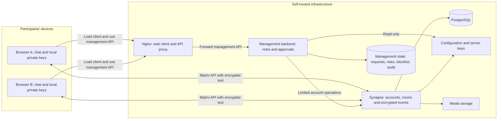

# Architecture and goals

Origrami aims to put communication data and operation in the hands of the people who use and maintain the service. This document explains the purpose, roles and current implementation boundaries.

| Document scope | Status |
|---|---|
| Origrami 0.1 | Local text-chat prototype with account-request management |

## Why Origrami exists

Personal messages, images and videos belong to the people who share them. Messenger users should choose where data lives and who operates the infrastructure. Origrami supports self-hosting so that families, communities and organisations can run their own communications service.

**Host it yourself. Keep control of your infrastructure and leave private-content decryption to the participants' devices.** This offers an alternative to dependence on central messaging platforms.

Self-hosting determines storage and operation. End-to-end encryption is intended to ensure that administrators need no private message keys for their work. Together, these support the intended level of data ownership.

## What the service should provide

The goal is an everyday messenger for private and shared conversations. Text, images, videos and other private content should be encrypted before transmission and decrypted only on authorised recipient devices. Administrators should manage accounts, storage and availability without access to private content keys.

**This goal is not fully implemented.** Version 0.1 records the local text-chat prototype. Media sending, device verification and key recovery are missing. The project does not yet guarantee that a malicious operator cannot obtain private content.

## Responsibilities

| Role | Responsibility | Security boundary |
|---|---|---|
| Users | Protect credentials and devices, choose participants, send messages | An unlocked or compromised device can expose plaintext and keys. |
| Origrami admin | Review requests, manage ordinary users and maintain the blocklist | No native Matrix admin privileges; load metrics require superuser permission. No dashboard for reading other people's conversations. |
| Origrami superuser | Manage admins and grant access to load metrics | Admins cannot demote or deactivate superusers; this role grants no access to other people's conversation content. |
| Infrastructure operator | Maintain servers, updates, storage, backups and availability | Infrastructure access is outside Origrami role enforcement. A malicious operator remains part of the unresolved threat model. |
| Client publisher | Supply the code executed in browsers | Modified code could capture plaintext or keys. This role may also be held by the operator. |
| Project maintainers | Maintain source, dependencies, verification and documentation | Existing checks do not replace an independent security assessment. |

A server-side password reset can restore access to an account but not lost message keys. Reading a server backup does not replace recovery of device-held keys.

## System architecture

Application code is packaged into runtime images. Multi-stage builds and disposable test/development containers keep dependencies and generated output inside Docker rather than in the host checkout. See the [container build guide](builds.md).

The browser runs React and the Matrix SDK's cryptography. The self-hosted Synapse homeserver handles accounts, rooms and events. PostgreSQL stores server data; separate volumes hold configuration and media. The management backend enforces Origrami roles and handles requests, permissions and the blocklist. The [permission matrix](administration.md#roles) separates product roles from technical operator access.

Private message keys remain on devices. Management exposes no view of other people's messages or media. Media storage is part of the server architecture, but the Origrami client cannot send media yet. The [security model](../SECURITY.md) explains outstanding trust boundaries around the operator and client distribution.

The supplied deployment is local, closed and non-federated. It is not a complete guide for public Internet hosting. See [operations](operations.md) for installation and maintenance.

## Data visible to the operator

| Data | Current handling |
|---|---|
| Text encrypted by Origrami | The server receives encrypted events; decryption requires appropriate device-held message keys. |
| Accounts, device IDs and public device keys | Visible for server operation; public keys are not private decryption keys. |
| Room membership and state | Visible to the server, potentially including names, topics and profile information. |
| Connection and event metadata | IP addresses, times and traffic sizes may be visible or recorded in operational logs. |
| Unencrypted messages from other clients | May be stored as plaintext; room encryption alone does not prove every message was encrypted. |
| Images, videos and files | Not yet sendable through Origrami. Future media support must encrypt files and previews before upload; see [encrypted attachments](https://spec.matrix.org/latest/client-server-api/#sending-encrypted-attachments). |

Encrypted communication is not anonymous. Content protection and metadata exposure must be assessed separately.

## Implemented capabilities

- Sign-in to a fixed homeserver with direct public registration disabled.
- Account requests approved by admins before activation.
- Private rooms with end-to-end encryption enabled in their initial state.
- Text sending blocked in unencrypted rooms.
- Local crypto stores separated by homeserver, account and device.
- Server-bound sessions and exclusive browser locks on each device's crypto store; a second tab using the same store is rejected.
- Connection and decryption errors, and warnings for received plaintext messages.
- Admin/superuser permissions, user management, blocklist, activity log and restricted load statistics.

## Outstanding limitations

The [roadmap](roadmap.md) outlines planned Kubernetes deployment, mobile apps, identity provider integration, backup and recovery, custom emoji and interface improvements. These plans are separate from the capabilities already implemented above.

Device verification is not available. Encryption alone therefore does not establish that a newly reported device belongs to the expected person. Additional or substituted devices remain an important unresolved threat.

Encrypted key recovery and safe device transfer are also missing. Lost browser data or a new Matrix device can make previous messages permanently unreadable.

The publisher of the web client controls code executed on user devices. A malicious or compromised operator could modify that code to capture plaintext or keys. Independently verifiable client distribution and verified devices are needed for the broader goal.

End-to-end encryption does not prevent account suspension, data deletion or service interruption. Participants can copy and share received content. Protection depends on devices, software distribution and real-world handling as well as server configuration.

See the [security model](../SECURITY.md) for requirements, the [README](../README.md) for a quick start, and the [user guide](usage.md) for current workflows.
