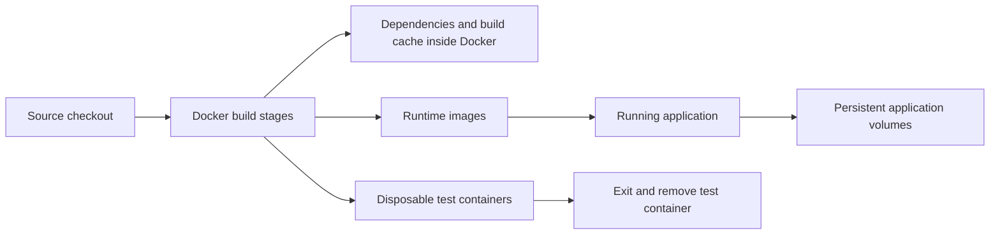

# Container build and development guide

Docker is the build environment as well as the runtime. You do not need Node.js, npm, Python or OpenSSL on the host. Keep the source checkout; installed dependencies and generated files live in Docker images or disposable containers.

## First-time configuration

Run from the project directory on Windows:

```powershell
docker compose -f compose.tools.yaml run --rm setup
```

On Linux/macOS, run as your host user so the private configuration file has the correct owner:

```sh
docker compose -f compose.tools.yaml run --rm --user "$(id -u):$(id -g)" setup
```

The one-time Python container writes only `.env` to the mounted project directory. It creates a random database password, never prints it, and preserves an existing file. No dependency directories are created. `.env` stays excluded from Git. The original shell/PowerShell setup scripts remain optional alternatives; only the shell alternative requires host OpenSSL.

## Build and run the application

```sh
docker compose -f compose.yaml -f compose.test.yaml up --build -d --wait
```

Compose builds three application images:

| Image | Build stages | Runtime contents |
|---|---|---|
| Web client | `dependencies` → `tooling` → `build` → `runtime` | Nginx and compiled web assets; no Node.js or npm dependencies |
| Management | Separate `test` and `runtime` targets | Python/Synapse runtime with packaged management code |
| Synapse bootstrap | Separate `tooling` and `runtime` targets | Synapse runtime with packaged bootstrap code |

Management and bootstrap no longer depend on source-file mounts at runtime. After changing source, rebuild with `up --build`. Data volumes are separate from images and remain intact during normal rebuilds.



Build runtime images without starting services:

```sh
docker compose -f compose.yaml build
```

The normal runtime configuration needs `.env`; initialise it first. The standalone tools file does not require application credentials or running application services for builds and tests.

## Disposable build and test containers

```sh
docker compose -f compose.tools.yaml run --rm --build web-build
docker compose -f compose.tools.yaml run --rm --build web-tests
docker compose -f compose.tools.yaml run --rm --build management-tests
docker compose -f compose.tools.yaml run --rm --build bootstrap-tests
```

`--build` refreshes each image from the current source. `--rm` removes the container when the command exits. A failed test returns a nonzero exit code. Existing suites cover 21 web tests, 16 management tests and 14 bootstrap tests.

The build command keeps compiled files at `/app/dist` in its image. It does not export them to the host. The web runtime build copies these files directly between image stages. Test containers have no runtime network access and no application-data mounts; bootstrap tests write only to a temporary in-container filesystem. Package/image downloads happen during the image build, before tests run.

Docker reuses dependency layers when `package-lock.json` has not changed. There is no need to run `npm ci` or create a virtual environment on the host.

## Live web development

Start the application stack first, then run:

```sh
docker compose -f compose.tools.yaml run --rm --build --service-ports web-dev
```

Open [localhost:5174](http://localhost:5174). The development container connects to the application's `origrami_frontend` network and proxies management calls to `management:8090`. Matrix requests use `http://localhost:8008` by default.

Only `web/src`, `web/public`, `web/index.html` and `web/vite.config.js` are mounted, read-only. Hot reload watches these source edits; `node_modules`, Vite caches and temporary configuration bundles stay in the container. Stop with Ctrl+C; the container is removed. If package definitions change, stop and rerun the command to rebuild dependencies.

Port 5174 is a separate browser origin from the normal application on 5173. Sessions and local message keys do not automatically transfer. Use disposable test accounts while developing.

For a custom application project/network, set `ORIGRAMI_RUNTIME_NETWORK` to that project's frontend network. `VITE_MATRIX_URL` can override the development homeserver. Keep any corresponding origin changes consistent with `ORIGRAMI_ALLOWED_ORIGINS`. These optional values can be set in your ignored local `.env`.

## Storage and cleanup

The source tree stays small, but Docker still needs disk space for downloaded images, dependency layers and application data. Removing a disposable tool container does not remove cached images. Inspect usage with:

```sh
docker system df
```

Use Docker Desktop's storage controls or deliberately remove unused build caches when necessary. Do not remove application volumes or use `down -v` as a build-cache cleanup step; those volumes contain accounts, messages, configuration and management state.

## Troubleshooting

| Problem | Resolution |
|---|---|
| Docker cannot start a build | Check Docker is running in Linux-container mode and has enough disk space. |
| Setup cannot write `.env` on Linux | Run it with your user/group IDs as shown above and check directory permissions. |
| Development network does not exist | Start the application stack first or set the correct `ORIGRAMI_RUNTIME_NETWORK`. |
| Port 5174 is in use | Stop the other development process/container before starting `web-dev`. |
| Source changes are not reflected in the runtime | Rebuild with `up --build`; runtime code is packaged inside images. |
| Dependency changes are not reflected in live development | Stop the development container and rerun with `--build`. |
| `node_modules` or `dist` exists locally | These are leftovers from host-based tooling, not required by this workflow. Keep them out of Git. |

See [operations](operations.md) for service maintenance and [verification](verification.md) for the recorded checks and limitations.
