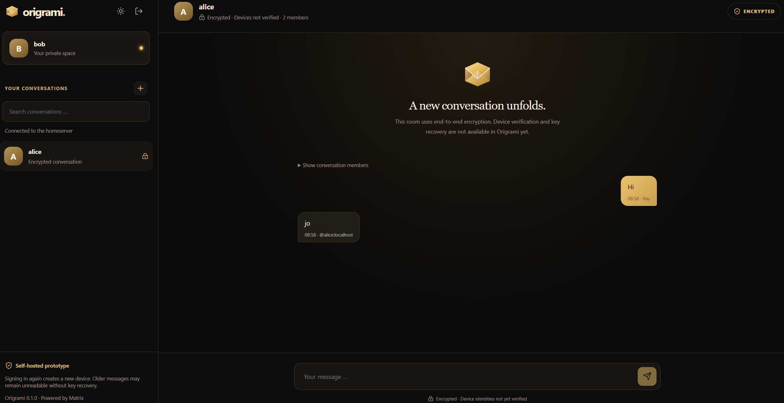

# User guide

Origrami 0.1 is a local test prototype. Its interface is in English. Text chats are supported; images, videos, files, calls and push notifications are not implemented yet.

Admins and superusers use the same chat interface as everyone else and also have **Server management**. See [administration](administration.md) for requests, receipts, roles and decisions.

## Before signing in

- Start the local installation; see [operations](operations.md).
- Have an account on the configured homeserver, or request one as described below.
- Use a current browser with IndexedDB and Web Locks support.
- Use a separate browser profile for each test user.

Origrami supports control of your own infrastructure and communication. The prototype still lacks device verification and key recovery. Use disposable test content. See the [security model](../SECURITY.md).

## Request an account

1. Choose **Request an account** on the sign-in page.
2. Enter an available username and a display name, then choose **Request access**.
3. Keep the private **receipt** safe. It is stored in the current tab and can be saved or restored through **Already have a receipt?**.
4. Wait for an admin or superuser to accept or reject the request. Use **Check status** or allow automatic updates.
5. Once accepted, choose a password of at least 12 characters and select **Activate account**.
6. Return to sign-in and use the new credentials.

An unapproved request does not create an account. The receipt authorises activation of the approved account, so treat it as a secret. The [registration diagram](../README.md#from-an-account-request-to-the-first-sign-in) and [detailed workflow](administration.md#registration-and-decisions) explain the process.

## Sign in

1. Open the provided Origrami URL; the default is [localhost:5173](http://localhost:5173).
2. Check the homeserver shown on the sign-in page. Sessions are bound to that server.
3. Enter your username and password.
4. Choose **Sign in** and wait for the conversation list and connection status.

The client synchronises existing rooms. **Connected to the homeserver** means synchronisation is running; it does not confirm participants' device identities.

If sign-in fails, check credentials and server availability. Repeated sign-ins do not recover missing message keys and may create additional Matrix devices.

## Start a conversation

1. Choose the plus button next to **YOUR CONVERSATIONS** or select **New conversation**.
2. Enter a recipient's username, such as `bob`, or a complete Matrix ID such as `@bob:localhost`.
3. Choose **Start private chat**.
4. The recipient opens the invitation in their own browser profile and chooses **Accept invitation**.

Origrami creates the room with end-to-end encryption enabled. The supplied closed deployment is intended for accounts on the same instance; entering an external Matrix ID does not automatically enable federation.

The client does not verify device identities yet. A lock icon therefore does not confirm that all devices were verified by you or your contact.

## Send text messages

1. Open a conversation and check its encryption status.
2. Enter text in the message field.
3. Choose the send button or press Enter.

Origrami blocks sending in unencrypted rooms. If a send fails, check whether the message arrived before retrying: a reported error does not always prove non-delivery.

Drafts survive switching conversations within the current view. They are not durable storage and may be lost when reloading or signing out.

## Start a group chat

1. Choose **New conversation** (the plus button), then **Group chat**.
2. Enter a group name and at least two other usernames or complete Matrix IDs. Separate recipients with commas, semicolons or new lines. You are included automatically; repeated IDs receive only one invitation.
3. Choose **Create encrypted group**. Each invited person selects the conversation and chooses **Accept invitation**.
4. Once participants have joined, exchange text messages as in a private chat. The group icon and name appear in the sidebar; **Show conversation members** lists joined and invited accounts.

Groups are private, invitation-only rooms with encryption enabled from creation. Message history is restricted to joined members: send shared messages after invitees accept. Group names and membership are room metadata visible to the server. Device verification and key recovery have the same limitations as private chats.

Renaming groups, inviting additional members after creation, removing members and leaving through the Origrami interface are not implemented yet.

## Understand chat notices

| Notice | Meaning and next step |
|---|---|
| Encrypted · Devices not verified | The room supports encrypted sending; device identities are not verified in Origrami. |
| Not encrypted / Sending blocked | Sending is blocked. Start a new encrypted conversation. |
| Received without encryption · Readable by the server | That message arrived as plaintext, for example from another client. Room settings do not encrypt it retroactively. |
| Decrypting … | The client is still trying to decrypt the event. Wait for synchronisation. |
| Unable to decrypt this message | This device lacks the appropriate message key. Signing in again or restoring a server backup does not recover it. |
| Disconnected or connecting … | Check connectivity and service availability, then wait for reconnection. |

Only a limited recent history is loaded initially. Loading older pages is not implemented. Missing older entries do not necessarily mean the server deleted them.

## Multiple tabs and devices

Crypto stores are separated by homeserver, account and Matrix device. Only one tab at a time may use a device's crypto store. Opening or duplicating the same session in another tab blocks the additional instance.

Close the tab already using the session before using it elsewhere. Do not clear site data in response to a lock error: the lock protects concurrent access and does not indicate that the store needs resetting.

Use separate browser profiles for Alice and Bob. Private browsing may delete all site data when closed and is unsuitable for retaining long-term message keys.

## Sign out and preserve keys

Choose the sign-out icon in the sidebar. Once successful, Origrami revokes the server token and removes the local session reference. If revocation is not confirmed, an error is shown; restore connectivity and retry.

Closing a tab is not confirmed server sign-out. Tokens are stored in tab session storage and may become unavailable after closing; crypto data is stored separately in IndexedDB. Browsers may restore closed tabs or sessions.

**Signing in again creates a new Matrix device.** Its crypto store does not automatically contain the previous device's keys. Old messages may remain unreadable after successful sign-in. Origrami currently has no key transfer, export or recovery workflow. See the [session and key checks](manual-tests.md#sessions-and-keys).

Do not delete site data or an existing browser profile as a general repair step. Server backups do not recover device-only keys, and administrators cannot replace them by resetting an account password.

## What administration can see

The goal is to operate the service without private message keys. Normally, text encrypted by Origrami is decrypted only on participants' devices. Accounts, room memberships, room state, IP addresses and timestamps may remain visible to the operator.

A compromised device or modified web client may capture plaintext. The client does not yet provide complete protection against a malicious operator. Images and videos are planned but not implemented.

See [architecture and goals](architecture.md), [security](../SECURITY.md), the [README](../README.md) and [operations](operations.md).
